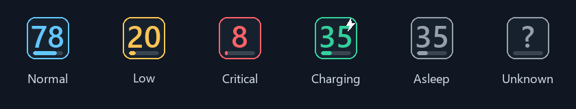

# Mouse Battery Tray

A Windows notification-area battery meter for the **VGN 2.4G receiver `3554:F503`**. Shows a number, a battery bar, low-battery alerts, charging status and a dimmed last reading while asleep/offline.



Only this receiver ID has been verified on real hardware (Windows 11 x64). The retail mouse model is not yet confirmed. Charging transitions still need hardware validation. Other VGN/Compx devices are not automatically claimed as supported.

## Run

Build on Windows using Python 3.10+:

```powershell
.\scripts\build.ps1
.\scripts\install.ps1
```

The resulting `dist\MouseBatteryTray.exe` runs without Python. Installation copies it to `%LOCALAPPDATA%\MouseBatteryTray` and adds a Start menu shortcut. Use `install.ps1 -Startup` or the tray menu to enable startup at sign-in. Exit the previous instance before updating.

Drag the icon out of Windows' hidden-icons area (`^`) to keep it next to the clock. Double-click to refresh; right-click for settings, notification test and exit. It is a separate icon, not a replacement for the laptop battery indicator.

Default: query every 60 seconds; alert at ≤20% and again at ≤10%, with 30-minute reminders per band. Charging or recovery above threshold +5 resets the cycle. Windows notification / Do Not Disturb settings may suppress notifications. Gray means stale/offline; `?` means no valid reading yet. Wake the mouse and refresh. Polling's impact on sleep/battery life has not been measured; 120-second polling is available.

## Develop

```powershell
py -3 -m venv .venv
.\.venv\Scripts\python.exe -m pip install -e '.[build]'
.\.venv\Scripts\python.exe -m unittest discover -s tests -v
.\.venv\Scripts\python.exe -m mouse_battery_tray --probe
.\.venv\Scripts\python.exe -m mouse_battery_tray
```

The GUI executable has no console; use Python for `--probe` JSON output. Builds are unsigned. GitHub Actions tests/builds Windows artifacts but does not publish releases automatically.

Settings and rotating logs are stored in `%LOCALAPPDATA%\MouseBatteryTray`. Runtime uses no network and never reads pointer movement or clicks. Only connection (`0x03`) and battery (`0x04`) telemetry queries are sent; no pairing, DPI, firmware or lighting changes. Only the first matching receiver (sorted by HID path) is read if multiple identical receivers are attached.

Uninstall: disable startup through the tray menu, quit, then delete the app directory and Start menu shortcut. The startup registry value is `HKCU\Software\Microsoft\Windows\CurrentVersion\Run\MouseBatteryTray`.

See [protocol notes](docs/protocol.md), [contribution guide](CONTRIBUTING.md), [dependencies](THIRD_PARTY.md) and the [Chinese README](README.md). MIT licensed; not affiliated with VGN or Compx.
