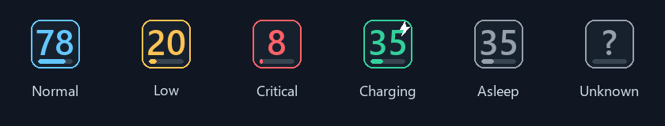

# Mouse Battery Tray

**把无线鼠标电量放到 Windows 任务栏，别等闪红灯才想起充电。**

Windows 10/11 的轻量托盘工具：直接显示电量数字，低电量变色并通知；鼠标休眠时保留上次读数并变灰。无需管理员权限，不需要安装厂商驱动。



English documentation: [README.en.md](README.en.md)

## 当前支持

| 设备 | USB VID:PID | 状态 |
| --- | --- | --- |
| VGN Mouse 2.4G Receiver | `3554:F503` | 在 Windows 11 实机验证在线、电量和休眠状态；尚未实测充电状态变化 |

具体鼠标商品型号尚未确认。只自动匹配这个接收器，不把其他 Compx/VGN 型号默认列为兼容。若插着多个同型号接收器，当前版本只读取按 HID 路径排序后的第一个。

## 使用

1. 从源码构建后，运行 `dist\MouseBatteryTray.exe`，无需 Python 或管理员权限。
2. 移动鼠标使其上线；首次显示 `?` 时，双击图标刷新，或等待下次轮询。
3. Windows 可能把新图标放入 `^` 隐藏区域。将图标拖到时钟旁，或在「设置 → 个性化 → 任务栏」中打开对应托盘图标。工具不会替换系统电池图标。
4. 右键图标可调整刷新频率、低电量阈值、通知及开机启动，或退出。

图标显示电量数字，下方细条表示剩余比例。正常为蓝色，低于或等于提醒阈值为黄色，`≤10%` 为红色，充电为绿色并显示闪电，离线为灰色。悬停可查看电压、充电状态或上次有效读数的时间。

默认每 **60 秒**查询一次，电量 **≤20%** 提醒，**≤10%** 再提醒；同一档位最多每 30 分钟重复提醒一次。充电或电量恢复到阈值以上 5 个百分点后重置提醒周期。Windows 通知设置或勿扰模式可能抑制弹出通知；可从右键菜单测试通知。

### 休眠行为

接收器插在 USB 上不代表鼠标在线。先查询在线状态，只在在线时读取电量；离线时保留本次运行期间最后一个有效读数并变灰，重启程序后没有读数则显示 `?`。不会将“没读到”显示为 `0%`。恢复在线后最迟在下一个轮询周期更新，也可手动刷新。

工具定期发送查询，可能影响某些固件的休眠行为，尚未测量对续航的影响；可选择 120 秒降低查询频率。不会发送配对、DPI、灯光、升级或恢复出厂命令。

### 安装到固定位置

在 **Windows PowerShell** 中，在仓库目录执行：

```powershell
.\scripts\install.ps1             # 安装并启动，不自动设置开机启动
.\scripts\install.ps1 -Startup    # 同时设置当前用户登录时启动
```

安装位置为 `%LOCALAPPDATA%\MouseBatteryTray\MouseBatteryTray.exe`，添加开始菜单快捷方式。也可在托盘菜单中切换「Start with Windows」。**更新前请先从托盘退出旧版本。**

卸载：从托盘关闭开机启动并退出，删除安装目录及开始菜单中的 Mouse Battery Tray 快捷方式即可。如果无法启动旧程序，可从注册表 `HKCU\Software\Microsoft\Windows\CurrentVersion\Run` 删除 `MouseBatteryTray` 值。

## 开发与打包

需要 Windows、Python 3.10+。实际构建验证环境：Windows 11 x64、Python 3.13。

```powershell
py -3 -m venv .venv
.\.venv\Scripts\python.exe -m pip install -e '.[build]'
.\.venv\Scripts\python.exe -m unittest discover -s tests -v
.\.venv\Scripts\python.exe -m mouse_battery_tray --probe
.\.venv\Scripts\python.exe -m mouse_battery_tray
```

打包为单文件 EXE：

```powershell
.\scripts\build.ps1
```

产物为 `dist\MouseBatteryTray.exe`。构建使用 PyInstaller；当前产物未做代码签名。GitHub Actions 会在 Windows 上运行测试并上传以提交哈希命名的构建产物；当前没有自动发布 Release。`requirements-build.txt` 固定本次验证使用的构建依赖版本。

`--probe` 是源码调试接口，会输出一次 JSON；离线返回 `online:false,battery:null`。使用 `.venv` 中的 Python 执行，窗口版 EXE 不提供终端输出。

## 数据与隐私

应用运行时不联网、不上报数据、不读取鼠标移动或点击内容。仅在支持的厂商 HID 接口上发送两个只读遥测命令：`0x03`（在线状态）、`0x04`（电量）。设置和轮询日志保存在 `%LOCALAPPDATA%\MouseBatteryTray`。日志单个上限约 256 KB，最多两个备份；包含电量、状态和本地时间。首次安装依赖和打包需要联网。

## 项目结构

```text
src/mouse_battery_tray/
  protocol.py   HID 查询、校验、超时和重连
  state.py      最后有效电量、通知节流
  icon.py       数字托盘图标绘制
  app.py        Windows 托盘、设置、启动项、后台轮询
tests/          协议捕获回归、错误回复、休眠、提醒周期测试
scripts/        Windows 构建与安装
docs/           协议说明与图标预览
```

欢迎为新型号补充支持：请提供 USB VID/PID、HID usage page/usage、系统版本及脱敏的回复样本，并分别验证在线、休眠和充电状态。不要把未验证的设备加进自动匹配列表。见 [CONTRIBUTING.md](CONTRIBUTING.md)。

## 协议资料与许可

实现使用独立编写的遥测代码，帧结构参考 [python-pulsar-mouse-tool](https://github.com/andrewrabert/python-pulsar-mouse-tool)，并对照本机已安装的 V HUB 2.3.44 驱动及接收器原始回复验证。协议细节见 [docs/protocol.md](docs/protocol.md)。依赖及其许可证见 [THIRD_PARTY.md](THIRD_PARTY.md)。

MIT License。本项目与 VGN、Compx 无隶属关系。
